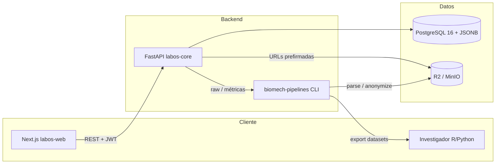

# STACK_INFO — Pila tecnológica oficial

Versiones de referencia y configuración recomendada. El objetivo es un stack
**gratuito, open source, tipado y portable**.

---

## 1. Resumen

| Capa | Tecnología | Versión objetivo |
|---|---|---|
| Lenguaje backend | Python | 3.11 – 3.12 |
| Framework API | FastAPI | 0.115+ |
| Validación | Pydantic / pydantic-settings | 2.x |
| ORM | SQLModel sobre SQLAlchemy 2.x | 0.0.22+ |
| Migraciones | Alembic | 1.14+ |
| Base de datos | PostgreSQL | 16 |
| Driver | psycopg 3 | 3.2+ |
| Auth | PyJWT (HS256) + pwdlib/Argon2 | 2.10+ |
| Frontend | Next.js App Router | 15.x |
| UI runtime | React | 19.x |
| Lenguaje frontend | TypeScript | 5.7+ |
| Estilos | Tailwind CSS | 3.4 |
| Componentes | shadcn/ui (Radix UI) | última estable |
| Gráficos | Recharts | 2.15+ |
| Iconos | lucide-react | última estable |
| Tests web | Vitest + Testing Library | 3.x |
| Pipelines | pandas + Pydantic + Typer | 2.2+ / 2.x / 0.15+ |
| Object storage | Cloudflare R2 / S3 compatible (MinIO, s3mock) | API S3 |
| CI/CD | GitHub Actions | — |
| Hosting web | Vercel | Free |
| Hosting API | Render / Railway / VPS | Free o existente |
| Contenedores | Docker + Compose | 24+ |

---

## 2. Arquitectura



**Fronteras**

- `labos-core` es la única puerta de escritura a PostgreSQL.
- Los binarios nunca se guardan en la base: solo metadatos, URL y hash SHA-256.
- `biomech-pipelines` no conoce credenciales de pacientes; recibe archivos y produce
  datasets seudonimizados.
- `labos-web` no accede a la base directamente: siempre a través de la API.

---

## 3. Backend — `labos-core`

### 3.1 Estructura

```text
labos-core/
├── app/
│   ├── api/v1/
│   │   ├── endpoints/{auth,pacientes,evaluaciones,investigaciones}.py
│   │   ├── deps.py
│   │   └── router.py
│   ├── core/{config,security}.py
│   ├── db/{base,session}.py
│   ├── models/{paciente,evaluacion,archivo,usuario}.py
│   ├── schemas/{paciente,evaluacion,usuario,common}.py
│   ├── services/storage.py
│   └── main.py
├── migrations/               # Alembic
├── tests/
├── Dockerfile
├── alembic.ini
├── pyproject.toml
├── requirements.txt
├── requirements-dev.txt
└── .env.example
```

### 3.2 Esquema de datos (PostgreSQL)

```sql
CREATE TABLE pacientes (
    id               UUID PRIMARY KEY,
    nombre           VARCHAR(120) NOT NULL,
    apellido         VARCHAR(120) NOT NULL,
    fecha_nacimiento DATE,
    dni_anonimizado  VARCHAR(64) NOT NULL UNIQUE,
    metadata         JSONB NOT NULL DEFAULT '{}'::jsonb,
    created_at       TIMESTAMPTZ NOT NULL DEFAULT now(),
    updated_at       TIMESTAMPTZ NOT NULL DEFAULT now()
);

CREATE TABLE evaluaciones (
    id                 UUID PRIMARY KEY,
    paciente_id        UUID NOT NULL REFERENCES pacientes(id) ON DELETE CASCADE,
    tipo_protocolo     VARCHAR(60) NOT NULL,
    fecha              TIMESTAMPTZ NOT NULL,
    dispositivo_origen VARCHAR(80) NOT NULL,
    datos_raw          JSONB NOT NULL DEFAULT '{}'::jsonb,
    created_at         TIMESTAMPTZ NOT NULL DEFAULT now()
);
CREATE INDEX ix_evaluaciones_paciente_fecha ON evaluaciones (paciente_id, fecha DESC);

CREATE TABLE archivos_adjuntos (
    id              UUID PRIMARY KEY,
    evaluacion_id   UUID NOT NULL REFERENCES evaluaciones(id) ON DELETE CASCADE,
    url_storage     TEXT NOT NULL,
    tipo_archivo    VARCHAR(16) NOT NULL,
    hash_sha256     CHAR(64) NOT NULL,
    nombre_original VARCHAR(255),
    tamano_bytes    BIGINT,
    created_at      TIMESTAMPTZ NOT NULL DEFAULT now()
);
```

**JSONB**: `datos_raw` admite series temporales, métricas por canal y metadatos del
dispositivo. Se recomienda:

```json
{
  "schema_version": "1.0",
  "dispositivo": {"modelo": "Biobit", "firmware": "2.3"},
  "frecuencia_muestreo_hz": 1000,
  "metricas": {"altura_salto_cm": 34.2, "tiempo_vuelo_ms": 512},
  "series": {
    "fuerza_n": {"unidad": "N", "valores": [0, 12.4, 88.1]},
    "tiempo_s": {"unidad": "s", "valores": [0, 0.001, 0.002]}
  }
}
```

Índices GIN sugeridos cuando el volumen lo requiera:

```sql
CREATE INDEX ix_evaluaciones_datos_raw_gin ON evaluaciones USING GIN (datos_raw jsonb_path_ops);
```

### 3.3 Configuración y secretos

- Toda configuración pasa por `app/core/config.py` (pydantic-settings).
- `SECRET_KEY` debe tener ≥ 32 bytes; en producción, generada con
  `python -c "import secrets; print(secrets.token_urlsafe(48))"`.
- Nunca se commitea `.env`; solo `.env.example`.
- El seed de administrador (`ADMIN_EMAIL`/`ADMIN_PASSWORD`) es opcional y se aplica una
  sola vez al iniciar; luego debe rotarse la contraseña.

### 3.4 Calidad

| Herramienta | Comando | Umbral |
|---|---|---|
| Ruff lint | `ruff check .` | 0 errores |
| Ruff format | `ruff format --check .` | 0 diferencias |
| mypy | `mypy app` | 0 errores |
| pytest | `pytest --cov=app` | ≥ 80 % rutas críticas |
| Bandit (opcional) | `bandit -r app` | 0 high |

---

## 4. Frontend — `labos-web`

### 4.1 Estructura

```text
labos-web/
├── app/
│   ├── (auth)/login/
│   ├── (dashboard)/
│   │   ├── profesionales/{pacientes,investigacion}/
│   │   └── pacientes/
│   ├── (public)/{publicaciones,equipo}/
│   ├── api/auth/{login,logout}/
│   ├── api/labos/[...path]/       # proxy autenticado hacia la API
│   ├── layout.tsx
│   └── globals.css
├── components/{ui,shared,biomechanics}/
├── lib/{api-client,types,utils}.ts
├── middleware.ts
├── public/
└── .env.example
```

> Next.js no permite dos rutas que resuelvan a `/`. El landing vive en
> `app/(public)/page.tsx`; **no** debe existir un `app/page.tsx` adicional.

### 4.2 Decisiones de UI

- **Server Components** por defecto; `"use client"` solo para interactividad y gráficos.
- **shadcn/ui** copiado al repo (no dependencia opaca) con Radix + CVA.
- Paleta clínica: azul profundo (`primary`), verde azulado para métricas, neutros cálidos.
- Tipografía del sistema para evitar descargas en build.
- Gráficos Recharts accesibles con tooltip, ejes rotulados y leyenda.
- Formularios con estados de carga/error explícitos; nunca mostrar datos reales en demo.

### 4.3 Seguridad de sesión

- El login pasa por un Route Handler de Next (`/api/auth/login`) que guarda el JWT en una
  cookie **httpOnly, Secure en producción, SameSite=Lax**.
- El cliente no lee el token; las llamadas al backend usan el proxy `/api/labos/*`.
- `middleware.ts` protege `/profesionales` y `/pacientes` verificando presencia de cookie
  (la validación criptográfica la hace la API en cada request).
- Para producción con cookies cross-site se requiere dominio compartido o proxy; el
  diseño actual evita CORS en el navegador.

### 4.4 Calidad

| Herramienta | Comando |
|---|---|
| ESLint | `npm run lint` |
| Prettier | `npm run format:check` |
| TypeScript | `npm run typecheck` |
| Vitest | `npm run test` |
| Build | `npm run build` |

---

## 5. Pipelines — `biomech-pipelines`

### 5.1 Modelo canónico

```python
SesionNormalizada(
    fuente="biobit",
    id_externo="...",
    fecha=datetime,
    sujeto_codigo="<seudónimo>",
    protocolo="salto_vertical",
    dispositivo="Biobit",
    metricas={"altura_salto_cm": 34.2},
    series=[SerieTemporal(canal="fuerza_n", unidad="N", frecuencia_hz=1000, valores=[...])],
    archivos=[ArchivoReferencia(nombre="salto.c3d", sha256="...", tipo="c3d")],
    metadata={...},
)
```

### 5.2 Formatos soportados

| Formato | Parser | Estado |
|---|---|---|
| CSV Biobit | `parsers/biobit.py` | Base + aliases configurables |
| CSV/JSON mDurance | `parsers/mdurance.py` | Base + aliases configurables |
| C3D | `parsers/c3d.py` | Lectura de cabecera y metadatos (sin señales) |
| CSV genérico tidy | `parsers/csv_generic.py` | Estable |
| MP4 | `parsers/media.py` | Metadatos vía `ffprobe` si está disponible |

> Los adaptadores propietarios se validan con muestras reales antes de producción. Los
> alias de columnas se documentan y versionan; un cambio de exportación genera un test.

### 5.3 Privacidad

- Seudonimización determinista: `HMAC-SHA256(salt, id_real)[:32]`.
- La sal vive en el gestor de secretos, nunca en el dataset.
- Eliminación recursiva de claves sensibles (`nombre`, `apellido`, `dni`, `email`,
  `telefono`, `direccion`, `fecha_nacimiento`).
- Desplazamiento de fechas opcional por sujeto, preservando intervalos.
- Los tests usan datos sintéticos; no se versionan datos reales.

---

## 6. Entornos

| Entorno | Base de datos | Storage | API | Web |
|---|---|---|---|---|
| Local | Docker PostgreSQL 16 | S3Mock (perfil `storage`; MinIO opcional) | `localhost:8000` | `localhost:3000` |
| Preview | Supabase/Neon branch o DB staging | R2 bucket staging | Render preview | Vercel preview |
| Producción | Supabase/Neon | R2 producción | Render/VPS | Vercel |

### 6.1 Variables

Backend: ver `labos-core/.env.example`.
Frontend: ver `labos-web/.env.example`.
Pipelines: ver `biomech-pipelines/.env.example`.
Compose: ver `.env.example` raíz.

### 6.2 Comandos de referencia

```bash
# Stack mínimo (PostgreSQL + API)
docker compose up --build

# Stack completo (+ storage S3 local + web)
docker compose --profile storage --profile web up --build

# Backend local sin Docker
cd labos-core && python -m venv .venv && . .venv/Scripts/activate
pip install -r requirements-dev.txt
alembic upgrade head && uvicorn app.main:app --reload

# Frontend local
cd labos-web && npm install && npm run dev

# Pipelines
cd biomech-pipelines && pip install -e ".[dev]" && biomech --help
```

---

## 7. CI/CD

| Workflow | Disparador | Acciones |
|---|---|---|
| `ci.yml` (core) | push/PR a `main` | Ruff, mypy, pytest (3.11/3.12), migraciones contra PostgreSQL |
| `ci.yml` (web) | push/PR a `main` | Prettier, ESLint, tsc, Vitest, build |
| `ci.yml` (pipelines) | push/PR a `main` | Ruff, mypy, pytest (3.11/3.12) |
| `ci-*.yml` (raíz) | push/PR con filtros de path | Equivalente para el monorepo |

Convención de checks requeridos en `main`: `lint`, `typecheck`, `test`, `build`.

### 7.1 Despliegue gratuito recomendado

1. **PostgreSQL**: Supabase (500 MB) o Neon (0.5 GB). Usar connection string con
   `sslmode=require`.
2. **Storage**: Cloudflare R2 (10 GB, sin egress). Crear bucket privado y credenciales
   S3; configurar CORS para el dominio web.
3. **API**: Render Web Service (Docker) o Fly.io; health check `/health`.
4. **Web**: Vercel conectado a `labos-web`; `NEXT_PUBLIC_API_URL` apunta al backend.
5. **Migraciones**: job manual `alembic upgrade head` o paso en el deploy.
6. **Respaldos**: `pg_dump` semanal a R2 + retención de 30 días.

---

## 8. Límites y riesgos conocidos

| Riesgo | Mitigación |
|---|---|
| Free tier de Render duerme por inactividad | Health check externo o VPS; aceptar latencia en demo |
| Supabase pausa proyectos inactivos | Cron de ping semanal o Neon |
| R2 requiere tarjeta | S3 local (s3mock/MinIO) para desarrollo; evaluar Backblaze B2 |
| JSONB crece sin control | Límite de tamaño por evaluación, series en archivos C3D/Parquet |
| Deriva de formatos de dispositivos | Tests de contrato con muestras; versión de parser |
| Reidentificación por hash | Sal secreta + control de acceso + k-anonimato en agregados |
| Costos ocultos de egress | R2 sin egress; Vercel dentro de límites |

---

## 9. Roadmap técnico resumido

| Fase | Entregable |
|---|---|
| 0 | Sustrato, docs, auth, CRUD, CI (actual) |
| 1 | Uploads reales a R2, visor C3D/MP4, migraciones en CI |
| 2 | Ingesta asíncrona (cola), normalización automática, catálogo de protocolos |
| 3 | Analítica, informes PDF, portal paciente completo |
| 4 | Federación de datasets, DOI, integración con repositorios académicos |
