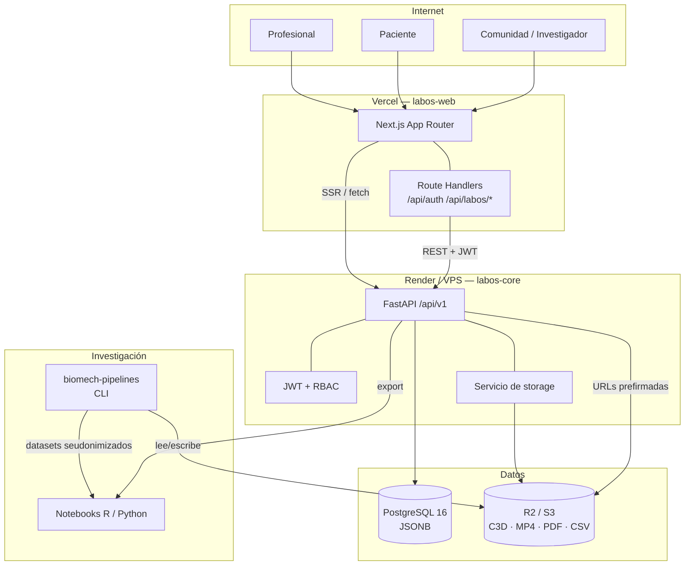
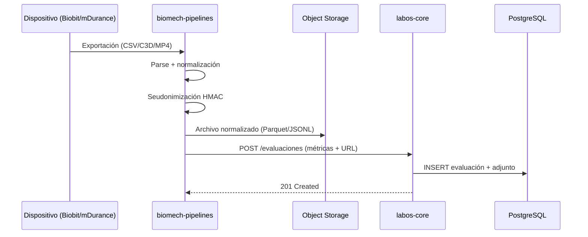

# Arquitectura — LabOS

## 1. Vista general

## 2. Flujos principales

### 2.1 Alta de una evaluación

1. El profesional inicia sesión en `labos-web`; el Route Handler guarda el JWT en cookie
   httpOnly.
2. El frontend crea el paciente (`POST /api/v1/pacientes`) o lo selecciona.
3. Se registra la evaluación con protocolo, fecha, dispositivo y `datos_raw`
   (`POST /api/v1/evaluaciones`).
4. El binario (C3D/MP4/PDF/CSV) se sube a R2/S3 mediante URL prefirmada (fase 1).
5. Se registra el adjunto con URL, tipo y SHA-256 (`POST /evaluaciones/{id}/archivos`).
6. La evaluación queda disponible para clínica e investigación.

### 2.2 Exportación de investigación

1. El investigador consulta `/investigaciones/resumen`.
2. Filtra por protocolo, dispositivo y rango de fechas.
3. Descarga `/investigaciones/dataset?formato=csv`.
4. La API aplica RBAC, excluye identificadores directos y entrega el `dni_anonimizado`.
5. Para análisis profundo, `biomech-pipelines` normaliza y anonimiza archivos crudos con
   la misma sal, preservando la trazabilidad entre sesiones.

### 2.3 Ingestión desde dispositivos

## 3. Fronteras y dependencias

| Componente | Puede | No puede |
|---|---|---|
| `labos-web` | Llamar a la API; renderizar datos autorizados | Conectarse a PostgreSQL o storage |
| `labos-core` | Leer/escribir DB; firmar URLs; validar JWT | Ejecutar parsing pesado en el request |
| `biomech-pipelines` | Leer archivos; generar datasets; hashear | Autenticarse como usuario clínico |
| `PostgreSQL` | Persistir dominio y JSONB | Almacenar binarios |
| `R2/S3` | Almacenar binarios y exports | Ser fuente de verdad de permisos |

## 4. Seguridad

- **Autenticación**: OAuth2 password flow → JWT HS256 con expiración (8 h por defecto).
- **Autorización**: RBAC en dependencias FastAPI; cada endpoint declara roles permitidos.
- **Transporte**: HTTPS obligatorio en producción; HSTS en Vercel/Render.
- **Cookies**: httpOnly, Secure, SameSite=Lax; sin token en `localStorage`.
- **CORS**: lista explícita de orígenes; nunca `*` con credenciales.
- **Secretos**: variables de entorno; rotación documentada; `.env` ignorado.
- **Auditoría** (fase 1): tabla `audit_log` para accesos a datos clínicos.
- **Rate limiting** (fase 1): en el proxy o middleware, por IP y usuario.
- **Backups**: `pg_dump` cifrado semanal; pruebas de restauración trimestrales.
- **Archivos**: validación de MIME y tamaño; hash SHA-256; URLs prefirmadas de corta vida.

## 5. Observabilidad

- Logs JSON estructurados con `request_id`, usuario y ruta (sin datos clínicos).
- `/health` (liveness) y `/health/ready` (DB).
- Sentry (free) para errores del backend y frontend.
- Métricas mínimas: latencia p95, tasa de error, evaluaciones/día, tamaño de storage.

## 6. Decisiones abiertas

| Tema | Opciones | Criterio |
|---|---|---|
| Cola de ingestión | Celery+Redis / RQ / Cloudflare Queues | Volumen y costo; empezar sincrónico |
| Auth avanzada | Keycloak / Auth.js / JWT propio | Simplicidad vs. SSO institucional |
| Series temporales | JSONB / Parquet en R2 / TimescaleDB | Tamaño de sesiones y consultas |
| Visor C3D | three.js / plotly / componente propio | Necesidad clínica real |
| Búsqueda | PostgreSQL FTS / Meilisearch | Volumen de publicaciones |

Las decisiones se documentan en `docs/adr/`.
