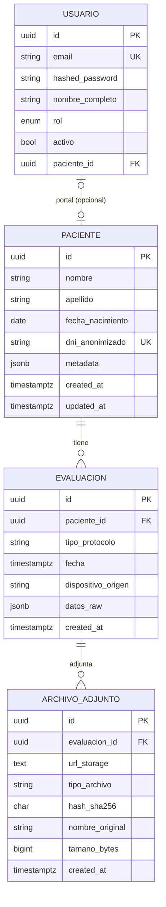

# Modelo de datos

## 1. Diagrama entidad-relación



## 2. Reglas

| Regla | Implementación |
|---|---|
| Paciente único por DNI seudonimizado | `UNIQUE (dni_anonimizado)` |
| Borrado en cascada | `ON DELETE CASCADE` en evaluaciones y adjuntos |
| Fecha de evaluación obligatoria | `NOT NULL`, con zona horaria |
| Protocolos controlados | Validación en schema + catálogo en `app/models/evaluacion.py` |
| Hash íntegro | `CHAR(64)` + validación hexadecimal |
| JSONB indexable | Índice GIN opcional por volumen |
| Sin PII en `datos_raw` | Sanitización en pipeline y validación en API |

## 3. Catálogo de protocolos

| Código | Nombre | Unidad principal |
|---|---|---|
| `salto_vertical` | Salto vertical (CMJ/SJ) | cm |
| `salto_horizontal` | Salto horizontal | cm |
| `marcha` | Análisis de marcha | m/s, s |
| `emg` | Electromiografía | mV |
| `fuerza` | Curva fuerza-tiempo | N |
| `equilibrio` | Estabilidad / posturografía | mm, ° |
| `movilidad` | Rango de movimiento | ° |
| `otro` | Otro protocolo | — |

Dispositivos de origen iniciales: `Biobit`, `mDurance`, `C3D`, `Manual`, `Otro`.

## 4. JSONB `datos_raw`

### 4.1 Estructura recomendada

```json
{
  "schema_version": "1.0",
  "dispositivo": {
    "marca": "Biobit",
    "modelo": "Pro",
    "firmware": "2.3.1",
    "numero_serie": "BB-0000"
  },
  "protocolo": {
    "codigo": "salto_vertical",
    "variante": "CMJ",
    "intentos": 3,
    "superficie": "plataforma_de_fuerza"
  },
  "frecuencia_muestreo_hz": 1000,
  "metricas": {
    "altura_salto_cm": 34.2,
    "tiempo_vuelo_ms": 512,
    "pico_fuerza_n": 1820.5,
    "asimetria_pct": 4.1
  },
  "series": {
    "tiempo_s": {"unidad": "s", "valores": [0.0, 0.001, 0.002]},
    "fuerza_n": {"unidad": "N", "valores": [0.0, 12.4, 88.1]}
  },
  "calidad": {
    "valido": true,
    "observaciones": "Sin artefactos visibles"
  }
}
```

### 4.2 Límites

- Tamaño recomendado de `datos_raw`: **< 1 MB** por evaluación.
- Series extensas (> 100k muestras): almacenar como Parquet/C3D en R2 y dejar en JSONB
  solo resumen, frecuencia y puntero al archivo.
- `schema_version` obligatorio para migraciones futuras.
- No incluir nombre, apellido, DNI, email, teléfono ni dirección.

## 5. Seudonimización

```text
seudónimo = HMAC-SHA256(salt_institucional, id_real)[:32]
```

- La sal se guarda en el gestor de secretos (`BIOMECH_ANON_SALT`), nunca en el dataset.
- El mismo sujeto conserva el mismo seudónimo entre exportaciones mientras no rote la sal.
- Rotar la sal invalida la correlación histórica: hacerlo solo con un plan de migración.
- Los agregados publicados deben tener k ≥ 5 para reducir reidentificación.
- Las fechas pueden desplazarse por sujeto (`--date-shift-days`) manteniendo intervalos.

## 6. Diccionario de datos para investigadores

Cada exportación incluye:

- `dataset_version`
- `pipeline_version`
- `generated_at`
- `schema` (tipos y unidades)
- `filters` aplicados
- `salt_fingerprint` (primeros 8 hex del hash de la sal, no la sal)

Esto permite reproducibilidad sin exponer el secreto.

## 7. Migraciones

- Alembic versiona el esquema; `alembic upgrade head` en cada despliegue.
- Cambios destructivos requieren estrategia expand/contract.
- Los índices GIN se agregan cuando el volumen de evaluaciones supera ~50k.
- Los datos de prueba viven en `tests/`; nunca en migraciones.
